# Variable Beam Divergence for Optical Ground Stations

**B.Sc. thesis in physics** · Friedrich Schiller University Jena & Fraunhofer Institute for Applied Optics and Precision Engineering IOF · April–September 2026

*Design and Characterization of a Variable Beam Divergence System for Optical Ground Stations*

**Grade: 1.5** (written thesis 1.7 · defence 1.3; German scale, 1.0 = best)
Primary assessor: Prof. Dr. C. Spielmann (Quantum Electronics, FSU Jena) · Supervisor: D. Heinig (Adaptive Optics, Fraunhofer IOF) · Day-to-day supervision: P. Böttner (Fraunhofer IOF)

<p align="center">
  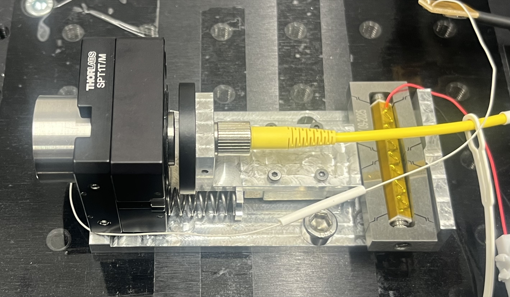
  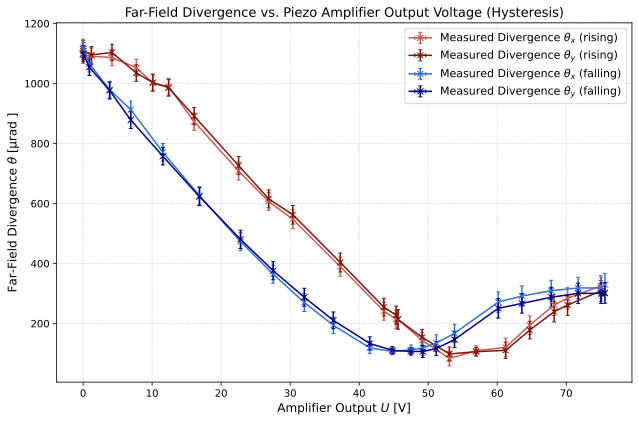
</p>
<p align="center"><em>The prototype I designed and built (left), and its main result (right): one voltage knob tunes the laser divergence by a factor of ~13.</em></p>

## The problem
Laser links between a ground station and a satellite can carry far more data than radio, and they are the backbone of future satellite quantum key distribution, for example in ESA's **EAGLE-1** mission. But before any data flows, the ground station has to *find* the satellite: a spot hundreds of kilometres away, moving fast, with an uncertain position.

The beam's **divergence** decides how this goes:
- a **wide** beam illuminates a large area, so the satellite is found quickly, but little power arrives;
- a **narrow** beam delivers a lot of power, but has to be pointed very precisely.

Ground stations with a fixed divergence must compromise. A system that can switch from wide (for acquisition) to narrow (for tracking) gets the best of both.

## The idea
A laser beam leaves an optical fibre and is collimated by a lens. If the fibre end sits exactly in the focal point, the beam is as parallel as possible. **Moving the fibre a fraction of a millimetre along the axis** makes the beam diverge, and how much is set by the distance.

So instead of zoom optics, deformable mirrors or extra lenses in the beam path, a **piezo actuator moves only the fibre**: no extra glass in the beam, few moving parts and a compact, light module.

## How I got there

### 1 · What divergence is needed?
I modelled the link with **Gaussian beam optics** (ABCD matrices, complex q-parameter), combined it with the geometry of a satellite pass in low Earth orbit and with **atmospheric turbulence** (Hufnagel–Valley C_n² profiles). The result is the operating window the system has to cover: **120 µrad ≤ θ ≤ 1120 µrad**, which corresponds to a fibre translation of about **251 µm**.

<p align="center">
  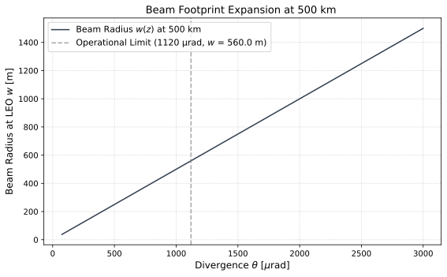
  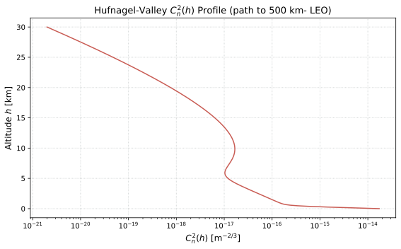
</p>

### 2 · Interactive simulation tool: finding the approach
Before settling on a design, I built an **interactive Python tool** ([`interactive-two-lens-tool/`](interactive-two-lens-tool)) to explore the options. With sliders for the lens distances, focal lengths and propagation length, it shows instantly how the beam radius evolves over 100 m and prints the effective focal length and divergence. The tool let me compare a second-lens setup with a simple fibre shift, and it led to the final approach: **moving the fibre relative to a single collimator** already covers the full divergence range.

<p align="center">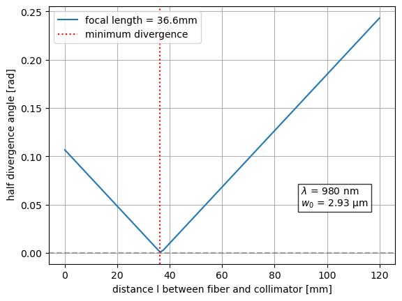</p>
<p align="center"><em>The V-shaped curve behind the whole thesis: divergence is smallest when the fibre sits in the focal point and grows on both sides.</em></p>

### 3 · Proving the principle on a test bench
On an optical breadboard I moved the fibre by hand with a micrometer stage and measured the beam with an **M² beam propagation analyser** (ISO 11146). The measured divergence follows the Gaussian-beam theory closely.

<p align="center">
  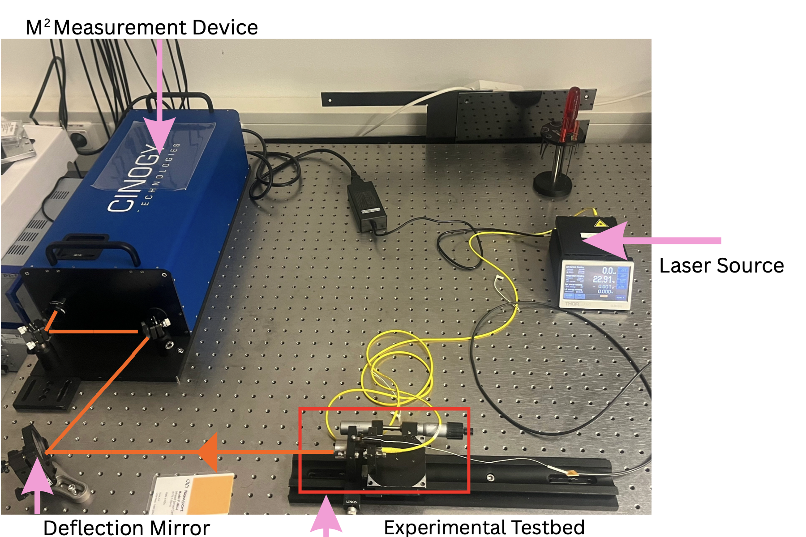
  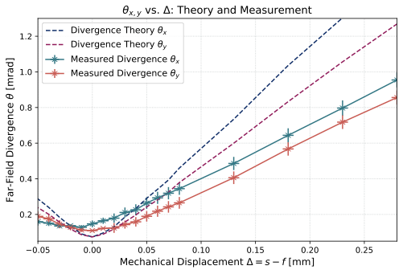
</p>

### 4 · Choosing the optics and the actuator
- **Lens choice:** ray tracing with Optiland and Zemax OpticStudio to compare a collimator doublet, a spherical and an aspheric lens (spot diagrams, aberrations, tolerances).
- **Actuator:** I characterised an amplified piezo actuator with **scanning laser vibrometry**. Its free stroke of up to **659 µm** is well above the 251 µm needed, leaving margin for hysteresis and load.

<p align="center">
  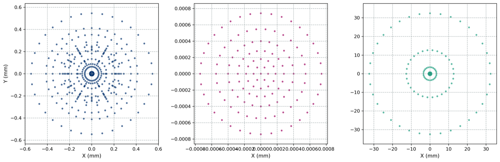
  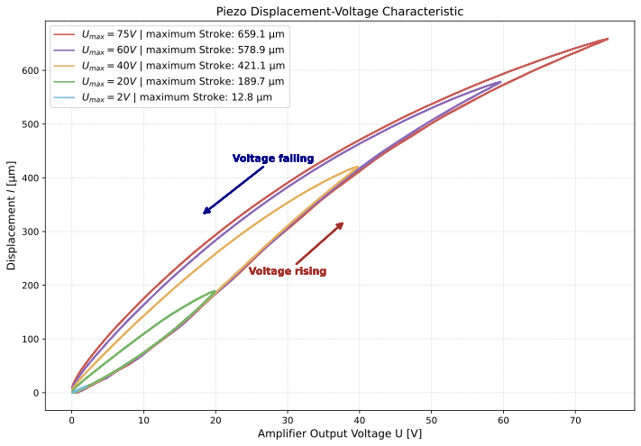
</p>

### 5 · The prototype
I designed the module in CAD and built it from machined and 3D-printed parts: the fibre sits on a linear guide driven by the piezo, an **eddy-current sensor** measures its position, and the lens group sits in an XY positioner for alignment.

<p align="center">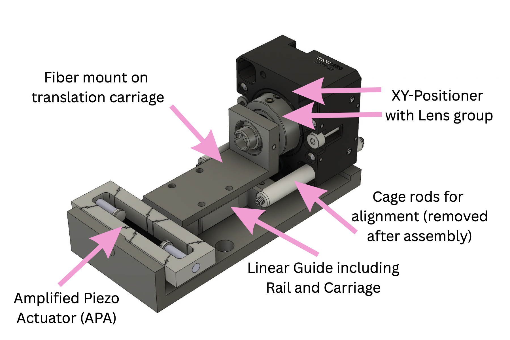</p>

### 6 · Characterisation and integration at the telescope
- **Divergence vs. voltage:** continuous tuning from **1120.5 µrad down to 83.5 µrad** (top figure), wider than the required window, with M² ≈ 1.35 across the range.
- **Frequency response:** stable stroke up to about **10–15 Hz**, fast enough for the switch between acquisition and tracking.
- **Integration:** the module was mounted on the 80 cm Cassegrain telescope of the IOF optical ground station, together with a closed-loop control concept for a future PAT system.

<p align="center">
  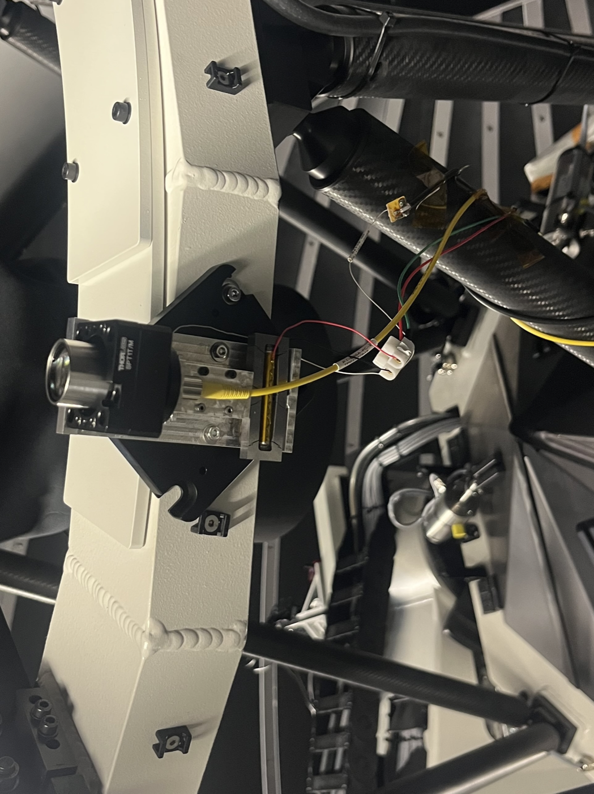
  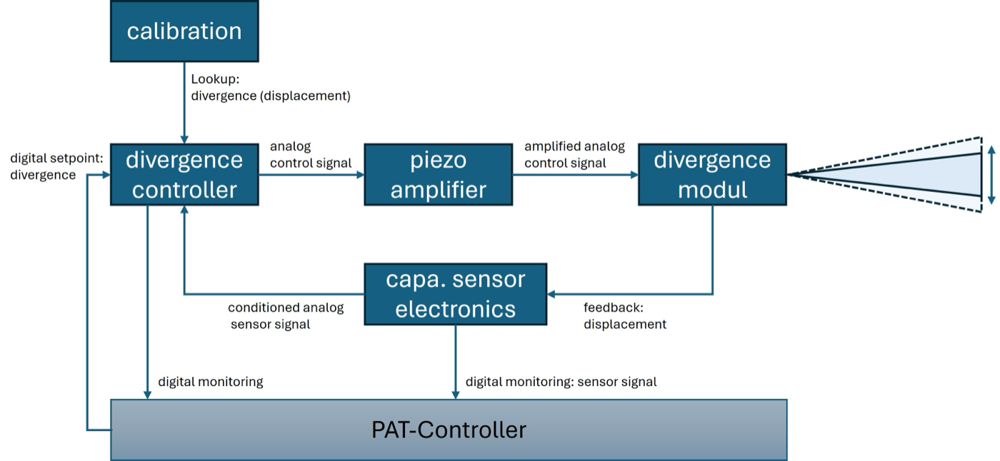
</p>

## Results at a glance

| | Requirement | Achieved |
|---|---|---|
| Divergence range | 120–1120 µrad | **83.5–1120.5 µrad** (~13×) |
| Fibre translation | ~251 µm | up to **659 µm** piezo free stroke |
| Beam quality | close to Gaussian | **M² ≈ 1.35** |
| Dynamics | PAT switching | usable up to **10–15 Hz** |
| Integration | ground-station telescope | **mounted at the IOF telescope** |

## Skills
Gaussian beam optics and ABCD matrices · atmospheric turbulence modelling · optical design and tolerancing (Zemax OpticStudio, Optiland) · M² beam diagnostics (ISO 11146) · scanning laser vibrometry · piezo actuators and eddy-current position sensing · CAD (Fusion 360, Creo), machining and 3D printing · Python data analysis and interactive tools (NumPy, SciPy, pandas, Matplotlib, ipywidgets)

## Repository layout

| Folder | Content |
|---|---|
| [`notebooks/`](notebooks) | Analysis notebooks, saved with their outputs: divergence requirements, turbulence, ray tracing, test-bench M² measurements, piezo characterisation, frequency response, prototype divergence vs. voltage |
| [`interactive-two-lens-tool/`](interactive-two-lens-tool) | The interactive simulation used to find the design approach |
| [`data/`](data) | Measurement data read by the notebooks |
| [`figures/`](figures) | Plots, photos and CAD renderings |

```bash
pip install -r requirements.txt
cd notebooks && jupyter lab
```
