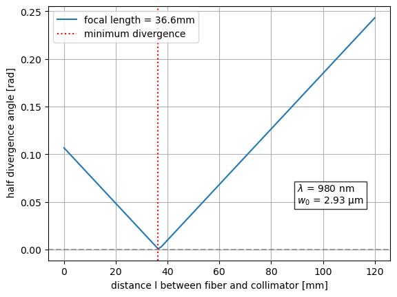

# Interactive Optics Simulation Tool 🔬💻

An interactive Jupyter tool I built during my bachelor thesis to find the right design approach for the variable-divergence module, before building any hardware.

<p align="center"></p>

## What it does
- Models **Gaussian beam propagation** through a fibre, a collimator and an optional second lens with ABCD matrices.
- **Sliders** (`ipywidgets`) for the fibre–lens distance *l*, the lens spacing *d* and the focal length *F₂*. Every change updates the plots immediately.
- Plots the beam radius *w(z)* over 100 m for the original and the adjusted beam.
- Prints tables with the effective focal length, the divergence angle θ and the beam radius at 1 m, 10 m and 100 m.

## Why it mattered
Playing with the parameters made clear that a second lens is not needed: shifting the fibre relative to a single collimator already tunes the divergence over the required range (the V-shaped curve above). This became the principle of the final prototype.

## Run it
```bash
pip install -r requirements.txt
jupyter lab two_lens_simulation.ipynb
```
